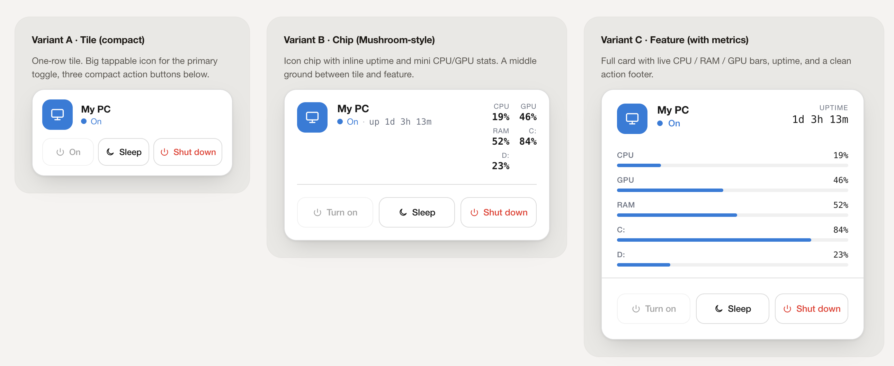

# PC Control Card

A Home Assistant Lovelace custom card for controlling a PC or NAS — **turn on, sleep, restart, shutdown** — with live CPU / RAM / GPU / storage metrics and physical-drive health.



**▶ [Live demo](https://solst1cee.github.io/HA-PC-control-card/)**

Three variants in one file:

- **`tile`** — compact, fits in a small dashboard slot. Tap the icon to toggle, or use the 3 action buttons below.
- **`chip`** — Mushroom-style: icon chip + inline status + uptime, with mini CPU/GPU stats when the PC is on.
- **`feature`** — full card with CPU / RAM / GPU / storage progress bars or graphs, physical-drive health, uptime, and a clean action footer.

All three variants follow your active Home Assistant theme (light & dark) via standard CSS variables. No build step. No external dependencies. Single JS file.

---

## Install

### Option A — HACS (recommended)

[](https://my.home-assistant.io/redirect/hacs_repository/?owner=Solst1cee&repository=HA-PC-control-card&category=plugin)

1. In HACS, open the kebab menu (top-right) → **Custom repositories**
2. Add `https://github.com/Solst1cee/HA-PC-control-card` as type **Dashboard** *(older HACS versions label this "Lovelace" or "Plugin" — same category)*
3. Find **PC Control Card** in the HACS frontend list and install
4. **Hard refresh** your browser (Ctrl/Cmd + Shift + R)

HACS adds the resource automatically. If your dashboard is YAML-managed, add it yourself:

```yaml
resources:
  - url: /hacsfiles/HA-PC-control-card/pc-control-card.js
    type: module
```

### Option B — Manual

1. Download `pc-control-card.js` from the [latest release](https://github.com/Solst1cee/HA-PC-control-card/releases)
2. Copy it to your HA config at `/config/www/pc-control-card.js`
3. Go to **Settings → Dashboards → ⋮ → Resources → Add Resource**
   - URL: `/local/pc-control-card.js?v=1`
   - Resource type: **JavaScript Module**
4. **Hard refresh** your browser

If you update the file later, **hard refresh** again — HA aggressively caches frontend resources. (Power users can also bump a `?v=` query on the resource URL to force a cache-bust.)

---

## Usage

Edit your dashboard → **Add card → Manual** → paste one of the snippets below.

### Tile (compact)

```yaml
type: custom:pc-control-card
variant: tile
name: My PC                                # heading shown on the card
icon: mdi:desktop-tower-monitor             # optional MDI/icon-pack icon; `pc` is the default
status_entity: binary_sensor.YOUR_PC_PING  # a sensor that's `on` when the PC is reachable (ping, agent heartbeat, WOL switch state, ...)
turn_on:  switch.YOUR_PC_WOL               # the entity that wakes the PC — WOL switch, script, etc.
sleep:    button.YOUR_PC_SLEEP             # a button/script your PC agent exposes for sleep
shutdown: button.YOUR_PC_SHUTDOWN          # a button/script your PC agent exposes for shutdown
confirm_shutdown: true                     # default — set false for single-tap shutdown
confirm_sleep: false                       # set true to require 2-tap confirm on sleep too
```

### Chip (Mushroom-style)

```yaml
type: custom:pc-control-card
variant: chip
name: My PC
status_entity: binary_sensor.YOUR_PC_PING
turn_on:  switch.YOUR_PC_WOL
sleep:    button.YOUR_PC_SLEEP
shutdown: button.YOUR_PC_SHUTDOWN
confirm_shutdown: true
confirm_sleep: false
metrics:
  cpu_usage:
    entity: sensor.YOUR_PC_CPU_PERCENT  # optional — shown inline next to the status
  ram_usage:
    entity: sensor.YOUR_PC_RAM_PERCENT  # optional
  gpu_usage:
    entity: sensor.YOUR_PC_GPU_LOAD     # optional
  storages:                         # optional — disks shown inline on chip
    - entity: sensor.YOUR_DISK_PERCENT
      name: System
```

### Feature (with metrics)

```yaml
type: custom:pc-control-card
variant: feature
name: My PC                                  # or "NAS" — same card works for both
status_entity: binary_sensor.YOUR_PC_PING    # `on` = device is reachable
turn_on:  switch.YOUR_PC_WOL                 # WOL / wake script
sleep:    button.YOUR_PC_SLEEP               # from your PC/NAS agent
shutdown: button.YOUR_PC_SHUTDOWN
confirm_shutdown: true
confirm_sleep: false

metrics:
  cpu_usage:
    entity: sensor.YOUR_PC_CPU_PERCENT
    display: bar
  cpu_temp:
    entity: sensor.YOUR_PC_CPU_TEMP
  ram_usage:
    entity: sensor.YOUR_PC_RAM_PERCENT
    # For absolute memory values, use:
    # total: sensor.YOUR_PC_RAM_TOTAL
  gpu_usage:
    entity: sensor.YOUR_PC_GPU_LOAD
  gpu_temp:
    entity: sensor.YOUR_PC_GPU_TEMP
  storages:                                 # one entry per disk — supports any number
    - entity: sensor.YOUR_DISK_1_USED       # sensor (used) — numeric, units come from the sensor
      total: sensor.YOUR_DISK_1_TOTAL       # OPTIONAL: if set, displays "used / total"
      name: System                          # optional label (default: "Disk", "Disk 2", …)
    - entity: sensor.YOUR_DISK_2_PERCENT    # percent sensor — no total = percent display
      name: Media
```

> Replace every `YOUR_PC_*` placeholder with your own entity IDs. The `turn_on` entity is whatever you already use to wake the PC — most setups use a Wake-on-LAN switch from the [`wake_on_lan`](https://www.home-assistant.io/integrations/wake_on_lan/) integration, but a `script`, `input_button`, or any service-callable entity works.

You can mix both — drop the tile on a phone view and the feature card on a wall display, both pointing at the same entities.

Native metric objects may use `display: graph` instead of `bar`. Graphs use recorder history and default to 24 hours; configure the period with `graph_hours` from 1 to 720:

```yaml
metrics:
  cpu_usage:
    entity: sensor.YOUR_PC_CPU_PERCENT
    display: graph
  custom:
    - entity: sensor.YOUR_PC_FAN_SPEED
      name: Fan
      unit: rpm
      display: bar
      max: 3000
    - entity: sensor.YOUR_PC_VERSION
      name: Version
```

Custom metrics support `entity`, `name`, `attribute`, `unit`, `template`, `display`, `max`, `max_entity`, and `max_attribute`.

### Custom metrics

Custom metrics live in `metrics.custom`. They are rendered after the built-in CPU,
GPU, RAM, and storage rows in the `chip` and `feature` variants. They are not
rendered by the compact `tile` variant.

The simplest custom row displays an entity value using its friendly name:

```yaml
metrics:
  custom:
    - entity: sensor.my_pc_fan_speed
```

Set `name` to control the label. Numeric values use the entity unit by default;
`unit` overrides it. Use `attribute` when the value is stored in an entity
attribute rather than its state:

```yaml
metrics:
  custom:
    - entity: sensor.my_pc_fan_speed
      name: Fan
      unit: rpm
    - entity: sensor.my_pc_network
      name: Network
      attribute: speed
      unit: Mbps
```

Text values are supported as well. Use `template` to format a value and,
optionally, its maximum. The placeholders are `{value}` and `{max}`:

```yaml
metrics:
  custom:
    - entity: sensor.my_pc_temperature
      name: CPU package
      unit: "°C"
      template: "{value}"
    - entity: sensor.my_pc_storage_health
      name: Health
      template: "Status: {value}"
```

Set `display: bar` to render a progress bar in the `feature` variant. A bar
defaults to a maximum of `100`; set a fixed `max` for another scale, or use
`max_entity` when the maximum comes from another sensor. `max_attribute` reads
that maximum from an attribute:

```yaml
metrics:
  custom:
    - entity: sensor.my_pc_fan_speed
      name: Fan
      unit: rpm
      display: bar
      max: 3000
      template: "{value} / {max}"
    - entity: sensor.my_pc_downloaded
      name: Downloaded
      unit: GB
      display: bar
      max_entity: sensor.my_pc_download_limit
      template: "{value} / {max}"
    - entity: sensor.my_pc_memory
      name: Memory
      attribute: used
      display: bar
      max_entity: sensor.my_pc_memory_info
      max_attribute: total
```

Set `display: graph` for a historical graph in the `feature` variant. The
entity must be recorded by Home Assistant's Recorder integration. Graphs use
`graph_hours` (24 hours by default, from 1 to 720 hours) and automatically
scale their range unless a maximum is configured. In the `chip` variant, custom
rows show their compact value; templates remain available as a tooltip.

Use `display: none` or omit `display` when a custom value should be shown
without a bar or graph. A custom metric with a non-numeric value can still be
used as a text/status row.

### NAS / Synology setup

The same card works for a NAS. **No agent is needed on the NAS** — Home Assistant's built-in **[Synology DSM](https://www.home-assistant.io/integrations/synology_dsm/)** integration provides the data:

- **Reboot** and **Shutdown** are native button entities → use them for `restart` and `shutdown`.
- **Volume** used / total / % and per-physical-**disk** status + temperature are native sensors.
- **Uptime** is a native sensor — but it's **disabled by default**, so enable it (and the **Volume Total size** sensor, also disabled by default, if you want "used / total" bars) under the integration's entities.
- **Powering the NAS on** isn't possible through the integration (the box is off), so `turn_on` uses **Wake-on-LAN**, exactly like a PC. `status_entity` stays a ping `binary_sensor`.

```yaml
type: custom:pc-control-card
variant: feature
name: NAS
icon: nas                                  # drive-bay header icon
status_entity: binary_sensor.nas_ping      # `on` = reachable (ping)
uptime_entity: sensor.nas_uptime           # enable this entity in the Synology integration
turn_on:  switch.nas_wol                   # Wake-on-LAN switch
restart:  button.nas_reboot                # native Synology DSM button
shutdown: button.nas_shutdown              # native Synology DSM button
confirm_restart: true
confirm_shutdown: true
metrics:
  cpu_usage:
    entity: sensor.nas_cpu_utilization_total
  ram_usage:
    entity: sensor.nas_memory_usage_real
  storages:                                # one bar per volume
    - entity: sensor.nas_volume_1_used_space
      total:  sensor.nas_volume_1_total_size   # enable Total size in the integration
      name: Volume 1
    - entity: sensor.nas_volume_2_used_space
      total:  sensor.nas_volume_2_total_size
      name: Volume 2
drives:                                    # one row per physical disk (health + temp)
  - status: sensor.nas_drive_1_status
    temp:   sensor.nas_drive_1_temperature
    name: Drive 1
  - status: sensor.nas_drive_2_status
    temp:   sensor.nas_drive_2_temperature
    name: Drive 2
```

> Entity IDs above follow the Synology DSM integration's naming — confirm yours in **Developer Tools → States**. Drive health shows a green dot when the status sensor reads one of `healthy_states` (default `normal`, `ok`, `healthy`, `good`) and red otherwise. In the chip variant, drives collapse to a `healthy/total` summary that turns red if any drive is unhealthy.

### HASS.Agent storage

[HASS.Agent](https://github.com/LAB02-Research/HASS.Agent)'s **Storage** sensor is a
*multi-value* sensor: it creates one entity per drive (e.g. `sensor.<pc>_storage_c`)
whose **state is the volume label** (a string like `Windows`), while the usable
numbers live in **attributes** — `UsedSpacePercentage`, `TotalSizeMB`, `UsedSpaceMB`, …

So pointing a disk straight at that entity would show nothing (the state isn't a
number). The card handles this two ways:

```yaml
metrics:
  storages:
    # Zero-config: a non-numeric state auto-detects `UsedSpacePercentage`.
    - entity: sensor.my_pc_storage_c
      name: "C:"

    # Or name the attribute explicitly (works for any attribute-based sensor):
    - entity: sensor.my_pc_storage_d
      attribute: UsedSpacePercentage
      name: "D:"
```

`UsedSpacePercentage` is the cleanest choice — it renders as `42%` with the bar
filled. For an absolute **used / total** readout, pair the MB attributes and add
`unit: MB` — the card auto-scales to GB/TB so you don't need any helper sensors:

```yaml
    - entity: sensor.my_pc_storage_c
      attribute: UsedSpaceMB
      total_attribute: TotalSizeMB
      unit: MB                # → renders e.g. "465 / 931 GB", scaling to TB as needed
      name: "C:"
```

> **What `unit` means:** it's the unit your sensor's values are **already in** (their
> *source* unit) — **not** the unit you want shown. HASS.Agent's `UsedSpaceMB` /
> `TotalSizeMB` are always megabytes, so it's always `unit: MB`. The card then
> **auto-picks** the display magnitude up the `B → KB → MB → GB → TB` ladder (a 488 GB
> disk shows GB; a 4 TB volume shows TB), keeping used and total in the same unit.
> So `unit: GB` here would be wrong — it'd tell the card those megabyte numbers are
> gigabytes and over-scale them to TB. Omit `unit` entirely and the raw numbers show
> as-is; scaling only happens when `unit` is set, so existing cards are unaffected.

---

## Configuration

| Key                | Required | Type                              | Default                  | Notes |
| ------------------ | -------- | --------------------------------- | ------------------------ | ----- |
| `variant`          | no       | `tile` \| `chip` \| `feature`     | `tile`                   | Layout |
| `name`             | no       | string                            | `"PC"`                   | Heading text |
| `status_entity`    | **yes**  | entity_id                         | —                        | A `binary_sensor` that reports `on` when the PC is reachable (ping / WOL / agent heartbeat / etc.) |
| `turn_on`          | no       | entity_id or `{entity, service}`  | —                        | Bare entity infers the service: `switch.*` → `switch.turn_on`, `button.*` → `button.press`, `script.*` → `script.turn_on`, `input_button.*` → `input_button.press`, `automation.*` → `automation.trigger` |
| `sleep`            | no       | same                              | —                        | Same |
| `restart`          | no       | same                              | —                        | Restart/reboot action (e.g. `button.nas_reboot`). Omit it to hide the button. |
| `uptime_entity`    | no       | sensor entity                     | —                        | When set, uptime is read from this sensor (timestamp or numeric duration) instead of `status_entity`'s `last_changed`. |
| `shutdown`         | no       | same                              | —                        | Same |
| `confirm_shutdown` | no       | boolean                           | `true`                   | When true, shutdown requires a 2-tap confirm. Set `false` to fire on a single tap. |
| `confirm_sleep`    | no       | boolean                           | `false`                  | Set `true` to require 2-tap confirm on sleep too. |
| `confirm_restart`  | no       | boolean                           | `true`                   | 2-tap confirm for Restart (reboot interrupts service). |
| `icon`             | no       | string                            | `pc`                     | Header glyph. Use the built-in `pc`/`nas`, or any installed Home Assistant icon namespace (for example `mdi:desktop-tower-monitor` or `phu:package-variant-closed`). |
| `healthy_states`   | no       | string[]                          | `[normal, ok, healthy, good]` | Status values (case-insensitive) treated as a healthy drive. |
| `drives`           | no       | array of `{ status, temp?, name? }` | —                      | One entry per physical disk. `status` is the text status sensor; `temp` an optional °C sensor; `name` the row label (default `Drive`, `Drive 2`, …). |
| `accent_color`     | no       | CSS color string                  | HA's `--primary-color`   | Override the accent for this card only (e.g. `"#7a5af8"`, `"#2f9e6e"`, `"oklch(0.65 0.18 145)"`). Different PCs can have different accents without touching your theme. |
| `graph_hours`      | no       | number                            | `24`                    | Recorder history period for graphs, clamped to 1–720 hours. |
| `metrics.<key>` | no | object `{ entity, display?, total?, attribute?, unit? }` | — | Native CPU/GPU/RAM metrics. `display` is `bar` or `graph` for the feature variant. |
| `metrics.storages` | no | array of storage objects | — | Logical volume usage entries. Supports `entity`, `attribute`, `total`, `total_attribute`, `unit`, `name`, and `display`. |
| `metrics.custom` | no | array of custom metric objects | — | Additional rows. Supports `entity`, `name`, `attribute`, `unit`, `template`, `display`, `max`, `max_entity`, and `max_attribute`. |

> **Deprecated aliases:** earlier versions used scalar `metrics.cpu`, `metrics.ram`, `metrics.ram_total`, and `metrics.gpu` values. The card still migrates them automatically, but new configurations should use metric objects.

If you need a specific service (e.g. `switch.toggle` instead of `switch.turn_on`):

```yaml
turn_on:
  entity: switch.my_pc
  service: switch.toggle
```

---

If you only need one or two action buttons, omit the unused action keys:

```yaml
type: custom:pc-control-card
variant: tile
name: My PC
status_entity: binary_sensor.YOUR_PC_PING
turn_on: switch.YOUR_PC_WOL
```

The remaining buttons grow to fill the row.

### Per-card accent color

Give each PC its own color without touching your theme — set `accent_color` per card:

```yaml
type: custom:pc-control-card
name: Gaming PC
accent_color: "#7a5af8"   # purple
# …

type: custom:pc-control-card
name: Office PC
accent_color: "#2f9e6e"   # green
# …
```

Accepts any CSS color string (hex, `rgb()`, `oklch()`, color names). Omit it and the card falls back to HA's `--primary-color`.

---

## Behaviour

- **Visual editor** — when you add or edit the card from the dashboard UI (not raw YAML), you get a form with entity pickers for each action, a color picker for `accent_color`, toggles for the booleans, and a dropdown for `variant`. Drop into Manual mode if you prefer YAML.
- **State** is derived from `status_entity`. While an action is pending, the card overlays a transitional state (Booting / Shutting down / Sleeping / Restarting) with a pulsing indicator and a spinner on the busy button.
- **Booting / Shutting**: cleared automatically when `status_entity` flips to the expected value (or after 90 s as a safety fallback).
- **Restarting**: shown after pressing Restart; cleared once `status_entity` dips (off/unavailable) and returns to `on`, or after a 5-minute safety fallback (NAS reboots are slow).
- **Sleeping**: displayed for 6 s after pressing Sleep — your `binary_sensor` likely can't distinguish sleeping from off, so this is a short visual confirmation rather than a sustained state.
- **Confirmation**: when armed, the destructive button changes label ("Shut down" → "Confirm?"). Both labels share a CSS grid cell so the button width never shifts.
- **Uptime** in the feature variant is computed from `last_changed` of your status sensor — or from a dedicated `uptime_entity` (a boot-time timestamp or numeric-duration sensor) when you set one.

---

## Theming

The card uses standard Home Assistant CSS variables, so light and dark themes work out of the box:

| CSS variable                  | Used for                       |
| ----------------------------- | ------------------------------ |
| `--primary-color`             | Accent (active icon, primary button background, metric bars) |
| `--card-background-color`     | Card background                |
| `--primary-text-color`        | Headings, button text          |
| `--secondary-text-color`      | Muted labels, status when idle |
| `--divider-color`             | Borders, button outlines       |
| `--error-color`               | Shutdown button text / armed tint |
| `--ha-card-border-radius`     | Card corner radius             |

To override the accent per-card (without changing your whole theme), you can use [`card_mod`](https://github.com/thomasloven/lovelace-card-mod) — a separate HACS plugin that lets you inject styles into any card:

```yaml
type: custom:pc-control-card
# …
card_mod:
  style: |
    :host { --primary-color: #7a5af8; }
```

`card_mod` is **optional** — the card works fine without it; you only need it if you want to override CSS variables for a single instance.

---

## Recommended companion integrations

- **Status sensor** — a `binary_sensor.ping` of the PC's LAN IP works great.
- **Turn on** — Wake-on-LAN (`wake_on_lan` integration → `switch` entity) or a script.
- **Sleep / shutdown** — an agent running on the PC that exposes buttons in HA. [HASS.Agent](https://github.com/LAB02-Research/HASS.Agent), [IOT Link](https://gitlab.com/iotlink/iotlink), or any MQTT-based shell command works.
- **Synology NAS** — the built-in [Synology DSM](https://www.home-assistant.io/integrations/synology_dsm/) integration provides CPU/RAM/temperature, per-volume usage, per-drive status/temperature, uptime, and native Reboot/Shutdown buttons — no agent required. Pair with Wake-on-LAN for power-on.
- **Metrics** — same agents typically expose CPU / RAM / GPU as sensors.

---

## Development

Card is a single ES module. No build step.

```bash
git clone https://github.com/Solst1cee/HA-PC-control-card.git
# Edit pc-control-card.js
# Copy to /config/www/ or symlink during development
```

Bump `CARD_VERSION` in the file before tagging a release — or just push a tag and let `.github/workflows/release.yml` stamp it for you and attach the file to the GitHub Release.

---

## Troubleshooting

| Symptom                                        | Fix |
| ---------------------------------------------- | --- |
| **"Custom element doesn't exist: pc-control-card"** | Resource isn't loaded. Recheck the install step, hard-refresh. |
| **Card shows "—" for uptime**                   | Status sensor isn't `on`, or it was just created (`last_changed` is "now"). |
| **Metric bars stuck at 0**                     | Confirm the sensor entity IDs in **Developer Tools → States**. Values must be numeric. |
| **Buttons fire the wrong service**             | Set both `entity` and `service` explicitly (see Configuration above). |

---

## License

[MIT](LICENSE)

---

## Credits

Inspired by the layout of HA's built-in **Tile** card and the [Mushroom](https://github.com/piitaya/lovelace-mushroom) family.
